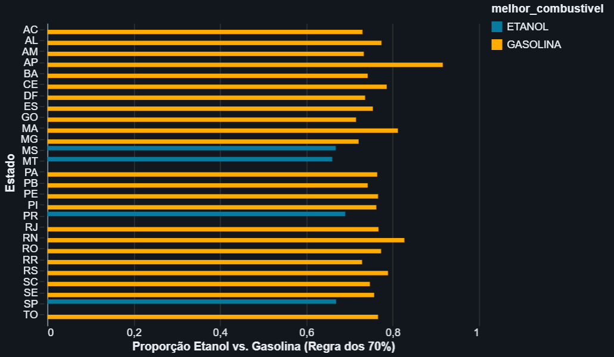
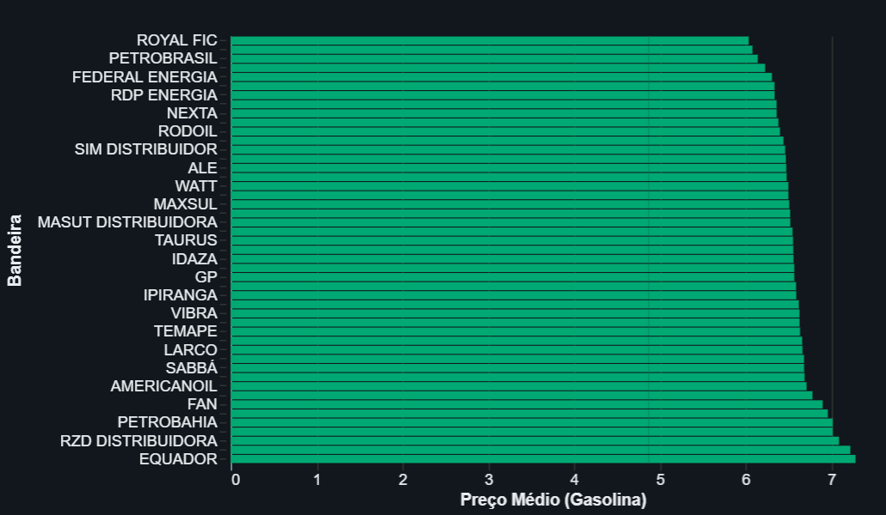
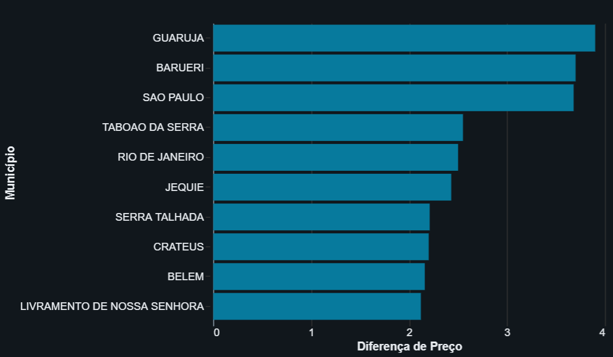
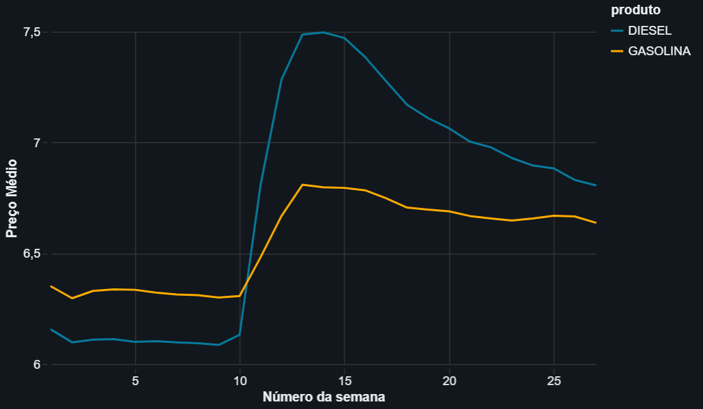

# Sistema de Suporte à Decisão para Gestão de Frotas

**Autor:** Gustavo Sardeiro  
**Disciplina:** Sistemas de Suporte à Decisão (SSD) - Engenharia de Produção, Universidade de Brasília (UnB).
**Professor:** Dr. André Serrano
---

## 1. Objetivo e Perguntas de Negócio
Este Minimum Viable Product (MVP) propõe um Sistema de Suporte à Decisão (SSD) *data-driven* para otimizar os custos logísticos de gestão de frotas. Utilizando dados de cotações de preços de combustíveis, o objetivo é abandonar decisões empíricas e basear o planejamento de abastecimento em inteligência geográfica e de mercado.

As 4 perguntas de negócio que orientam este MVP são:
1. Em quais estados a utilização do Etanol é financeiramente vantajosa em relação à Gasolina (Regra dos 70%)?
2. Como os preços médios da Gasolina variam entre as diferentes bandeiras de distribuidoras em cenário nacional?
3. Quais municípios apresentam a maior amplitude de preço, revelando praças onde a pesquisa ativa de preços gera maior economia?
4. Qual foi o comportamento temporal e a evolução semanal dos preços médios do Diesel e da Gasolina no semestre?

## 2. Coleta de Dados e Licença
* **Fonte:** Agência Nacional do Petróleo, Gás Natural e Biocombustíveis (ANP) - Série Histórica de Preços de Combustíveis e de GLP.
* **Período:** 1º Semestre de 2026.
* **Licença:** Dados Abertos do Governo Federal (compatível com Creative Commons).
* **Plataforma:** Ingestão e processamento realizados na nuvem via **Databricks SQL** (Serverless).

## 3. Transformação e Proteção de Dados (ETL)
Em observância à LGPD e ao princípio da minimização, a base bruta de 16 colunas foi sanitizada. O identificador do posto revendedor (CNPJ) foi pseudonimizado através de um hash criptográfico `SHA2(256)`. Colunas redundantes de endereço foram descartadas, e variáveis monetárias em formato de texto foram convertidas para `DECIMAL`.

*As evidências da carga persistida na nuvem encontram-se na pasta `/evidencias`.*

## 4. Modelagem Dimensional e Catálogo de Dados
A arquitetura de dados adotou o **Esquema Estrela** (*Star Schema*), separando a métrica de negócio em uma Tabela Fato (`fato_precos`) e seus contextos em quatro Tabelas Dimensão (`dim_data`, `dim_local`, `dim_produto`, `dim_bandeira`).

| Atributo Analítico | Tipo | Descrição no Domínio | Domínio de Valores | Obrigatoriedade | Linhagem (Transformação) |
| :--- | :--- | :--- | :--- | :--- | :--- |
| `id_posto` | Texto | Hash pseudonimizado do posto | Alfanumérico (16 char) | Sim | Gerado via SHA2(CNPJ, 256) |
| `regiao` | Categórico | Macroregião geográfica | N, NE, CO, SE, S | Sim | Limpeza TRIM/UPPER |
| `estado` | Categórico | Unidade Federativa (UF) | Siglas das 27 UFs | Sim | Limpeza TRIM/UPPER |
| `municipio` | Texto | Município da coleta | Nomes oficiais | Sim | Limpeza TRIM/UPPER |
| `produto` | Categórico | Combustível comercializado | ETANOL, GASOLINA, etc. | Sim | Limpeza TRIM/UPPER |
| `data_coleta` | Data | Data da pesquisa | AAAA-MM-DD | Sim | Conversão para DATE |
| `valor_venda` | Numérico | Preço final ao consumidor | Decimal > 0 | Sim | Conversão para DECIMAL |
| `bandeira` | Categórico | Marca da distribuidora | VIBRA, IPIRANGA, etc. | Sim | Tratamento de Nulos |

## 5. Auditoria e Qualidade de Dados
A base passou por 6 testes de qualidade dimensional antes da análise:
* **Unicidade:** Cotações exatamente duplicadas (mesmo posto, data e produto) removidas via particionamento analítico (`ROW_NUMBER`).
* **Completude:** Zero ocorrências de valores nulos nas métricas de preço.
* **Atualidade:** Base confirmada para a janela rigorosa de 01/01/2026 a 30/06/2026.
* **Acurácia:** Variações de preço validadas sem outliers impossíveis (Gasolina: Min R$ 5,09 / Max R$ 9,79).
* **Consistência e Conformidade:** Domínios geográficos (Estados x Regiões) e descrições de combustíveis devidamente padronizados.

*(Consultas detalhadas na pasta `/scripts` e prints dos resultados na pasta `/evidencias`).*

## 6. Resultados (Análise das 4 Perguntas)

### P1: Viabilidade Etanol vs. Gasolina (Regra dos 70%)
> **Decisão:** Apenas quatro estados (MT, MS, PR e SP) apresentaram viabilidade econômica para o Etanol. O SSD recomenda restringir o uso do biocombustível estritamente às rotas nessas regiões.
 

### P2: Variação de Preço por Bandeira
> **Decisão:** Bandeiras regionais (ex: Royal Fic, Federal Energia) cobram em média R$ 1,00 a menos por litro que distribuidoras de alto custo (ex: Equador). Recomenda-se homologar as frotas nas bandeiras mais baratas para reduzir o TCO.
 

### P3: Amplitude de Preços nos Municípios
> **Decisão:** Centros urbanos como Guarujá-SP e São Paulo-SP apresentam variações de até R$ 4,00 por litro na gasolina. Nesses locais, o desvio de rota para pesquisar preços gera alto ROI (Retorno sobre Investimento).
 

### P4: Evolução Semanal (Choques de Mercado)
> **Decisão:** O mercado sofreu um forte choque na 10ª semana de 2026, com o preço do Diesel ultrapassando a Gasolina. Infere-se que essa anomalia seja reflexo de fatores macroeconômicos externos (como as tensões geopolíticas no Irã), que impactaram a cotação do petróleo. Para a gestão de frotas, a exposição a esses riscos globais justifica investimentos em contratos de *hedging* (proteção financeira) para blindar o caixa da empresa.
 

## 7. Autoavaliação e Limitações
O MVP cumpriu seu objetivo respondendo às 4 perguntas gerenciais com suporte em nuvem. Contudo, há limitações:
* O escopo semestral não permite inferir tendências de sazonalidade anual (ex: variações de safra da cana-de-açúcar impactando o etanol).
* A amostra da ANP não reflete 100% dos postos do país e a média de preços calculada não é ponderada pelo volume real de vendas de cada posto (dado não divulgado pela agência).
* **Trabalhos Futuros:** O projeto pode ser evoluído conectando a base da ANP via API de forma automatizada para rodar o ETL semanalmente, cruzando essas cotações com planilhas de rotas internas da própria empresa transportadora.
